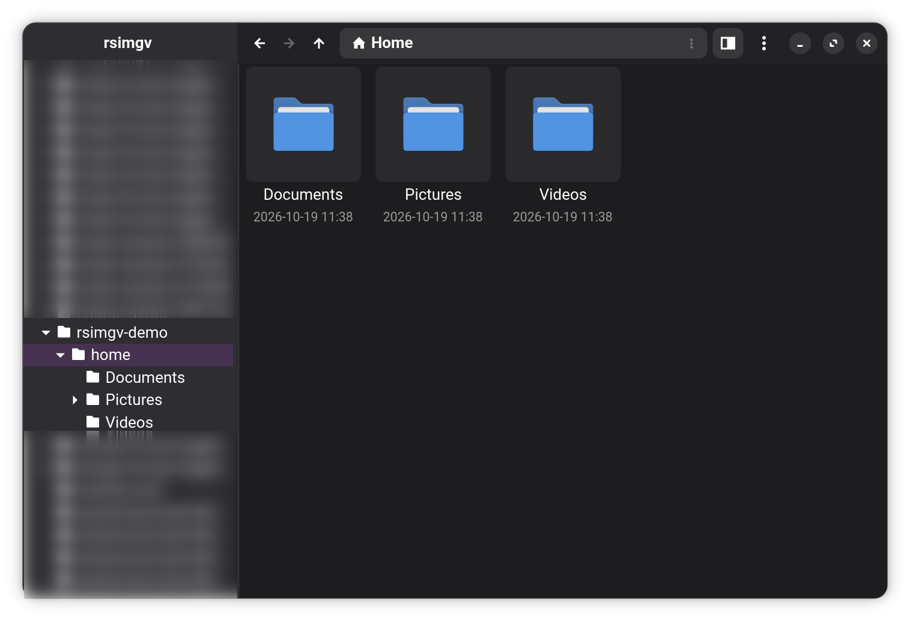

<div align="center">

# rsimgv

**An integrated file explorer and media viewer for GNOME.**

Written in Rust with GTK 4 and libadwaita.

<p>
  
  
  
  
  
  
  
  
  
  
  
</p>

</div>

rsimgv puts a folder tree, a browse grid and a navigation history side by side, so you can move through a
library of pictures and videos without leaving the window.

> **Status:** early development. The file explorer, media viewer and thumbnails are implemented, but the
> project is still changing quickly.



## Contents

- [Features](#features)
- [Requirements](#requirements)
- [Building and running](#building-and-running)
- [Command line](#command-line)
- [Settings](#settings)
- [Project layout](#project-layout)
- [Application ID](#application-id)
- [License](#license)

## Features

- **Folder tree** rooted at `/`. Folders expand on demand, and selecting one reveals its path. Expansion
  can keep other folders open or collapse them, and a path is framed so the folder and as many of its
  children as fit are on screen.
- **Browse view** showing the current folder as a grid of files and folders. Folders come first, then
  files, in natural name order. Item size is adjustable, names can be ellipsized or wrapped, and the info
  line shows size and modification time.
- **Media filter**: only pictures and videos are listed by default. Turn it off to see every file.
- **Path bar** in the header with clickable breadcrumbs. It starts at home when you are inside it, and at
  `/` otherwise. Middle-click or Ctrl-click opens a new tab or window (currently both navigate in place).
- **Navigation** with back, forward and up buttons. Long-pressing back or forward lists the history in
  that direction.
- **Manual location entry**: click the current folder in the path bar to type a path. A leading `~` means
  your home folder.
- **Settings** in a preferences dialog, saved as YAML and applied immediately.
- **Hidden files** can be shown from the main menu.

## Requirements

Build-time:

- Rust (stable) with `cargo`
- A C compiler and `pkg-config`
- Meson 1.2 or newer, and Ninja
- GTK 4.22 or newer, with development headers (`gtk4`)
- libadwaita 1.9 or newer (`libadwaita-1`)
- `sassc`, to compile the stylesheets
- `glib-compile-resources` and `glib-compile-schemas` (part of GLib)

## Building and running

For development, `dev.sh` sets up the build directory if needed, rebuilds, and runs the app from it:

```sh
./dev.sh          # rebuild and run rsimgv
./dev.sh test     # rebuild and run the test suite
```

Tests need a display. On a machine without one, run them under `xvfb-run -a`.

To build and install with Meson:

```sh
meson setup builddir --prefix=/usr/local
meson compile -C builddir
meson install -C builddir
```

Installing copies the GSettings schema and the application icons into the system data directories. The
program embeds its user interface, stylesheets and icons in a GResource bundle, so it does not need them
installed separately.

## Command line

```sh
rsimgv [FILE_OR_FOLDER...]
```

Each argument opens in a new tab of the open window, or of a new window if none is open. A folder opens
in its tab. A file opens in a tab on its folder with the file selected, and a picture or video also opens
in the viewer. A running rsimgv takes the arguments of a second launch. `rsimgv --version` prints the version.

## Settings

Settings are stored as YAML in `~/.config/rsimgv/rsimgv.conf`. Set `RSIMGV_CONFIG` to use another file.

```yaml
window:
  width: 960
  height: 640
  maximized: false
browse:
  show-hidden: false
  media-only: true
  item-size: 128
  filename-display: ellipsized
  show-directories: first-last
  info-fields: [size, modified]
tree:
  collapse-on-navigate: false
```

They are read and written through GSettings, using a backend that stores them in that file. Changes made in
the preferences dialog, from the menu, or by editing the file while the app runs all take effect straight
away. The schema is `data/au.topher.rimgv.gschema.xml`.

## Project layout

```
src/
  main.rs            application startup, actions, icon theme registration
  fs/                directory entries, lazy tree nodes, natural sort
  settings/          GSettings backend (backend.c) and YAML storage (store.rs)
  ui/                widgets: window, folder tree, browse view, path bar,
                     navigation bar, header bar, preferences, split view
data/
  ui/                GTK XML templates for every window and widget
  style/             SCSS, compiled to CSS at build time
  icons/             application and symbolic icons (hicolor theme layout)
  *.gschema.xml      GSettings schema
  rsimgv.gresource.xml  bundle manifest
build-aux/           build helper that runs cargo from Meson
```

The GObject subclass that connects GSettings to the YAML file is written in C (`src/settings/backend.c`),
because the Rust bindings do not expose the trait needed to subclass `GSettingsBackend`.

## Application ID

The application ID is `au.topher.rimgv`. The icons are currently named `au.topher.rsimgv`, so the app icon
will not resolve until the two agree.

## License

GPL-3.0-or-later.
